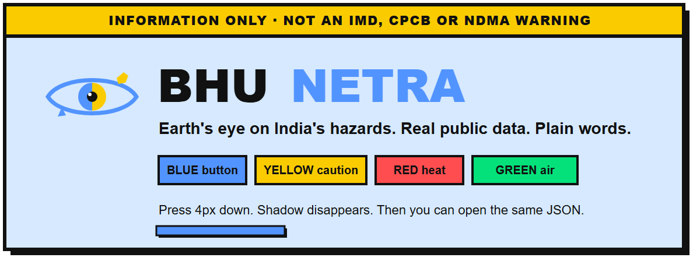

  


  
  


|                                                                                                                                                                                                                                                                                                                                                                                                                                                                                                                                     |
| ----------------------------------------------------------------------------------------------------------------------------------------------------------------------------------------------------------------------------------------------------------------------------------------------------------------------------------------------------------------------------------------------------------------------------------------------------------------------------------------------------------------------------------- |
| ⚡ **LIVE PUBLIC RESEARCH PAGE** ⚡**No login. No API key. Real-time public hazard telemetry for India.** [Launch Live Website](https://bhunetra-ai.tech/) |


---

> [!CAUTION]
> **⚠️ INFORMATION ONLY — NOT AN OFFICIAL ALERT (**`#facc00`**)**
> **BhuNetra is not a government site.** It is **not** an IMD, CPCB, or NDMA warning[cite: 1, 4]. Official instructions always outrank this screen[cite: 2]. **In an emergency, call** `112`**[cite: 1, 2].**

---


## 👁️ What is BhuNetra?

**BhuNetra** (*भूनेत्र*) means **earth's eye**[cite: 4, 5]. It is a free, open-source research project for India: one unified place where anyone can check **heat, rain, air quality, and recent earthquakes**, see the exact public source behind every single number, and inspect the raw JSON response themselves[cite: 1, 4].

```text
┏━━━━━━━━━━━━━━━━━━━┳━━━━━━━━━━━━━━━━━━━┳━━━━━━━━━━━━━━━━━━━┳━━━━━━━━━━━━━━━━━━━┓
┃  5                ┃  4                ┃  0                ┃  0–100            ┃
┃  HAZARDS NAMED    ┃  FETCHED LIVE     ┃  ACCOUNTS NEEDED  ┃  RISK INDEX       ┃
┃  Heat, Rain, Air, ┃  Direct from APIs ┃  No sign-up,      ┃  Not shown (no    ┃
┃  Quakes, Fire     ┃  on every search  ┃  no API keys      ┃  invented scores) ┃
┗━━━━━━━━━━━━━━━━━━━┻━━━━━━━━━━━━━━━━━━━┻━━━━━━━━━━━━━━━━━━━┻━━━━━━━━━━━━━━━━━━━┛
```

*(Key platform metrics as displayed on the live Home view[cite: 1].)*

---


## 🎯 Vision: The Opposite Bet

India already has hazard information, but it is scattered across agencies, written in a technical dialect, and easy to mistake for an official alert when a page looks official. **BhuNetra is the opposite bet.**


| `<kbd>STAMP</kbd>` | Core Commitment                                                                                                                                                 |
| ------------------ | --------------------------------------------------------------------------------------------------------------------------------------------------------------- |
| **01**             | **Plain Language (EN + HI):** A resident, a student, or an NGO worker can type any Indian city and read the numbers in plain English or Hindi[cite: 1, 4, 5].   |
| **02**             | **Radical Provenance:** Every number names its source, its timestamp, and **what it is not**[cite: 1, 3].                                                       |
| **03**             | **Reproducible Science:** A researcher can rerun the district heat study, compare it against a simple baseline, and see exactly where the model fails[cite: 4]. |
| **04**             | **Honest Blanks:** If an upstream source fails to answer, the card stays empty[cite: 3, 4]. **A missing value is never filled with zero[cite: 1, 3].**          |


### Who This Project Serves

- 🧑‍💻 **A Beginner:** Wants to trace how real environmental data moves from a public API to a browser screen without hidden black boxes.
- 🏘️ **A Citizen or NGO Worker:** Needs a transparent reading they can verify in seconds, paired with ordinary safety precautions[cite: 2].
- 🔬 **A Scientist:** Needs the train/test split, the baseline comparison, and the onset-recall failure modes written down in the open[cite: 4].

---


## 📡 What a Search Shows (Named Sources Only)

The public page queries **four named public sources** on search — nothing else, no stand-ins, and no guessed endpoints[cite: 1, 3].


| Hazard Card                   | What You Read on Screen                                                                            | Upstream Source                                                         | Variables & Scope                                                                         | What It Is NOT                                                                       |
| ----------------------------- | -------------------------------------------------------------------------------------------------- | ----------------------------------------------------------------------- | ----------------------------------------------------------------------------------------- | ------------------------------------------------------------------------------------ |
| 🔴 **01 · HEAT** `NOW / HEAT` | Current model temperature, plus the highest high and daily range over the next 3 days[cite: 1, 3]. | **[Open-Meteo Forecast](https://open-meteo.com/)**[cite: 3]             | `temperature_2m`, `temperature_2m_max`, `temperature_2m_min` (`forecast_days=3`)[cite: 3] | ❌ Not a street sensor. ❌ Not an IMD heatwave declaration[cite: 1, 2, 3].             |
| 🔵 **02 · RAIN** `RAIN`       | Total model precipitation summed across those same 3 days[cite: 1, 2].                             | **[Open-Meteo Forecast](https://open-meteo.com/)**[cite: 3]             | `precipitation_sum` (`forecast_days=3`, `timezone=auto`)[cite: 3]                         | ❌ Not a flood warning[cite: 1, 2].                                                   |
| 🟢 **03 · AIR** `AIR`         | Current US AQI and fine particulate matter ($\text{PM}_{2.5}$)[cite: 1, 3].                        | **[Open-Meteo Air Quality](https://open-meteo.com/)** *(CAMS)*[cite: 3] | `us_aqi`, `pm2_5` (~45 km coarse model grid over India)[cite: 3]                          | ❌ Not the Indian CPCB scale. ❌ Not a street-level station[cite: 1, 2, 3].            |
| 🟡 **04 · QUAKES** `QUAKES`   | Count & list of magnitude 3.0+ earthquakes within 300 km over the last 30 days[cite: 1, 3].        | **[USGS Earthquake Catalogue](https://earthquake.usgs.gov/)**[cite: 3]  | FDSN event query: `minmagnitude=3`, `maxradiuskm=300`, `limit=20`[cite: 3]                | ❌ Not an earthquake prediction. ❌ Zero events $\neq$ safety certificate[cite: 2, 3]. |
| ⚫ **05 · FIRE** `NOT LOADED`  | Explicitly marked `not loaded` on the public page[cite: 1].                                        | *NASA FIRMS (Held back)*[cite: 1]                                       | Requires an API key; a keyless page never invents fire detections[cite: 1, 2].            | ❌ No fake or placeholder detections[cite: 1, 2].                                     |


> 🔍 **Check This Yourself (**`Open JSON`**):**
> Under every searched city name, the interface prints the resolved coordinates (via **Open-Meteo Geocoding** with `countryCode=IN`[cite: 3]) and a direct **Open JSON** link for each upstream request. Every number displayed on a card can be verified inside that raw file.

---


## 🧭 Inside the 4-Page Interface

BhuNetra is organized into four focused views accessible from the top Neobrutalist navigation bar, alongside instant toggles for **Light / Dark Mode** and **English / हिंदी**[cite: 1, 5, 6]:

1. `[ Home ]` **— Search & Schematic Locator:**
  - Features instant city search (e.g., *Delhi, Mumbai, Chennai, Guwahati*) and an interactive **dot-matrix schematic locator of India** computed in the browser[cite: 1, 3]. *(Note: The locator drawing is a schematic only — not a survey map and not a statement about any boundary[cite: 1].)*
  - Displays the 5 hazard summary cards and the 3-step verification flow: **1. Type a city → 2. The page asks the source → 3. You get the number and the name**[cite: 1].
2. `[ Hazards ]` **— Know the Reading, Know What to Do:**
  - Pairs what the model shows with practical, everyday **Stay Safe** precautions[cite: 2]:
    - **Heat:** Drink water often, avoid hard outdoor work from 12 PM to 3 PM, and check on older neighbours[cite: 2].
    - **Rain:** Do not walk or drive through flood water, move valuables up, and keep a charged phone and torch[cite: 2].
    - **Air:** On bad AQI days keep windows closed, limit outdoor exercise, and wear an N95 mask outside[cite: 2].
    - **Quakes:** *Drop, Cover, and Hold On*; stay away from windows; check for gas leaks after shaking stops[cite: 2].
    - **Fires:** Follow local authorities, keep away from smoke, and evacuate early if instructed[cite: 2].
3. `[ Data ]` **— Where Every Number Comes From:**
  - Documents the exact variables fetched from Open-Meteo Forecast, Open-Meteo Air Quality, Open-Meteo Geocoding, and the USGS FDSN event API[cite: 3].
  - Includes **"Limits, in writing"** (an interactive FAQ on official warnings, why there is no 0–100 risk index, US AQI vs. CPCB, and where the ML forecast is) and **"What the search actually does"** (the 5-step execution pipeline)[cite: 3].
4. `[ About ]` **— Principles & Honest Gaps:**
  - Breaks down the three core pillars (**Real data only**, **Honest limits**, **Open to all**) and lists what is **Still outside this page** so that missing layers are documented as transparent gaps rather than hidden features[cite: 4, 6].

---


## 🎨 Neobrutalist Design System

The interface takes its high-contrast geometry, `2px` ink borders, border-radius, and tactile mechanical press from **[neobrutalism-components](https://www.neobrutalism.dev/)** (`[ekmas/neobrutalism-components](https://github.com/ekmas/neobrutalism-components)`), giving every color a strict functional job on a hazard page:


| Swatch                                                                 | Role               | Hex       | Functional Job on BhuNetra                                                                                                      |
| ---------------------------------------------------------------------- | ------------------ | --------- | ------------------------------------------------------------------------------------------------------------------------------- |
|  | **Page Blue**      | `#d6e9fe` | Light-mode paper background (same family as the component library)[cite: 6].                                                    |
|  | **Action Blue**    | `#5294ff` | Primary buttons, the word **NETRA**, active navigation tabs, dark-mode offset shadows, and **Rain** cards on hover[cite: 1, 2]. |
|  | **Caution Yellow** | `#facc00` | Top emergency disclaimer bar, badge stamps (`live`), step counters, and **Quake** cards on hover[cite: 1].                      |
|  | **Heat Red**       | `#ff4d50` | High-temperature alert accents, section highlights, and **Heat** cards on hover[cite: 1, 3, 4].                                 |
|  | **Air Green**      | `#05e17a` | Clearer air readings and **Air Quality** cards on hover.                                                                        |
|  | **Brutalist Ink**  | `#111111` | `2px` solid structural frame, dark-mode canvas, and `4px` hard offset shadows[cite: 1, 6].                                      |


### Tactile Button & Card Physics

Resting interactive elements sit `4px` up and to the left of a solid hard shadow. Hovering translates them `4px` down and right while collapsing the shadow in `160ms` (`ease-out`):

```css
/* Core Neobrutalist Mechanical Press */
transform: translate(4px, 4px);
box-shadow: none;
transition: transform 160ms ease-out, box-shadow 160ms ease-out;
```

- **Universal Press:** Applied across navigation pills, language/theme toggles, search bar, source cards, result cards, and `live` / `cached` stamps[cite: 1, 6].
- **Dark Mode Parity:** Flips the paper to near-black while keeping the four hazard accents and adding a `#5294ff` blue offset shadow so every mechanical press remains crisp against dark surfaces[cite: 1, 4].
- **Brand Iris:** The header and browser favicon feature a blue-and-yellow eye emblem representing *BhuNetra* ("Earth's Eye")[cite: 1, 6].

---


## 🖼️ Interface Showcase


| **Home View (Dark Mode)**[cite: 1]                                                      | **Hazards & Safety Guide**[cite: 2]                                                | **Data & Provenance View**[cite: 3]                                                            |
| --------------------------------------------------------------------------------------- | ---------------------------------------------------------------------------------- | ---------------------------------------------------------------------------------------------- |
| *City search, schematic dot-map of India, 4 live counters, and 5 hazard cards*[cite: 1] | *"Know the reading. Know what to do." Actionable safety steps per hazard*[cite: 2] | *Named upstream endpoints, written limits FAQ, and 5-step pipeline*[cite: 3]                   |
| **About View (Dark Mode)**[cite: 4]                                                     | **Bilingual Hindi View (**`हिंदी`**)**[cite: 5]                                    | **About View (Light Mode** `#d6e9fe`**)**[cite: 6]                                             |
| *Core principles and transparent documentation of what stays outside the page*[cite: 4] | *Complete factual parity in Hindi ("खतरे का डेटा जिसे कोई पढ़ सके।")*[cite: 5]     | *Light paper theme (*`#d6e9fe`*) with crisp white cards and* `#111111` *hard shadows*[cite: 6] |


---


## 💻 Run the Public Page Locally

The core public web application requires **Python 3.11+** and uses the **Python Standard Library only** (zero external dependencies required for the web server).

From the repository root (the page lives in `public/index.html`):

```bash
python serve.py
```

Then open **[http://127.0.0.1:8765/](http://127.0.0.1:8765/)** in your browser.

### How `serve.py` Works Under the Hood

1. **Concurrent Upstream Fetch:** Calls only the documented Open-Meteo and USGS endpoints — fetching weather, air quality, and earthquakes together.
2. **Transparent 10-Minute Memory Cache:** Keeps a successful response in memory for `10 minutes`[cite: 3]. If you search the same city again within that window, the badge honestly stamps `cached` rather than pretending the network was instant.
3. **Serverless Fallback:** If you open `public/index.html` directly in your browser without running `serve.py`, the client-side code queries those exact same four public endpoints directly from your browser tab.

### Deploy on Cloudflare Workers

The live site runs as a **Cloudflare Worker** with static assets. `public/` is served as static files, and `worker/index.js` answers `/api/geo`, `/api/weather`, `/api/air`, and `/api/quakes` with the same sources, checks, and 10-minute cache as `serve.py`. `wrangler.toml` wires the two together.

In the Cloudflare dashboard: **Workers & Pages → Create → Import a repository**, pick this repo, leave the build command empty, and keep the deploy command `npx wrangler deploy`.

---


## 🧪 Run the Heat Research Package & Streamlit Replay

Alongside the live public utility, this repository contains a reproducible **district-level heat spell research package** and a historical replay dashboard.

From the package directory, install the research dependencies, run the test suite, and launch the Streamlit replay app:

```bash
pip install -e ".[app,dev,ml]"
pytest
streamlit run app/streamlit_app.py
```


### Why the ML Model Is Held Back from the Public Page

We believe in reporting model failures openly rather than hiding behind an inflated overall accuracy badge[cite: 3, 4]:


| Research Metric / Choice   | Finding & Engineering Decision                                                                                                                                                   |
| -------------------------- | -------------------------------------------------------------------------------------------------------------------------------------------------------------------------------- |
| **Default Model**          | **3-Feature Logistic Regression** (selected because it outperformed `LightGBM` on **PR-AUC** in our validation checks; `LightGBM` remains in the repo for benchmark comparison). |
| **Spatial Sample**         | **60 Indian districts** (a research sample, *not* a national operational warning model).                                                                                         |
| **2024 Test Onset Recall** | Caught **19%** of heat spells 1 day ahead, **11%** 2 days ahead, and **25%** 3 days ahead on the day a heat spell starts[cite: 4, 6].                                            |
| **Product Decision**       | Because first-day onset recall is weak (`11–25%`), **the public page withholds the ML probability** and displays the transparent Open-Meteo forecast instead[cite: 4, 6].        |


📂 **Deep-Dive Documentation:**

- 📊 Model evaluation & metrics: `reports/heat_results.md`
- 🧭 Architectural & modeling trade-offs: `docs/decisions.md`
- 🗄️ Upstream dataset specifications: `DATA_SOURCES.md`

---


## 🇮🇳 हिंदी (Bilingual Support)

The public page carries the exact same facts in **Hindi** and **English** — switch anytime using the `हिंदी` **/** `English` button in the top header[cite: 1, 4, 5]. *(Research notes inside the code repository are maintained in English.)*

> **भूनेत्र (BhuNetra) का अर्थ है धरती की आँख[cite: 5]।**
> यह भारत के लिए एक खुला शोध पृष्ठ (open-source research page) है[cite: 5]। अपना शहर लिखें — गर्मी, बारिश, हवा की गुणवत्ता (AQI) और हाल के भूकंप के आँकड़े सीधे असली सार्वजनिक स्रोतों (public sources) से आते हैं। हर अंक स्पष्ट रूप से बताता है कि वह कहाँ से आया है, और वह क्या नहीं है।
>
> ⚠️ **यह IMD, CPCB या NDMA की आधिकारिक चेतावनी नहीं है[cite: 5]। आपात स्थिति में तुरंत** `112` **डायल करें[cite: 5]।**

---


## 🧱 Five Non-Negotiable Principles

1. **Real public data, or an honest empty card.** Never fill a failed API call with `0`[cite: 1, 3, 4].
2. **No guessed endpoints.** `public/index.html`, the Worker, and `serve.py` all call only documented, inspectable URLs[cite: 3].
3. **No single accuracy badge.** A model that misses most heat-spell onset days (`11–25%` recall) does not get to wear a misleading `95% accurate` badge[cite: 4, 6].
4. **Zero friction.** No account, no API key, and no sign-up for the core page[cite: 1, 4].
5. **Safety first.** Official government and disaster-management instructions always outrank this screen[cite: 2].

---


## 📬 Contact & License

- **Found a wrong number or a broken upstream source?** Reach out at **[hello@bhunetra-ai.tech](mailto:hello@bhunetra-ai.tech)**[cite: 1, 4, 6].
- **Code License:** Released under the **MIT License**.
- **Upstream Data Attribution:** Open-Meteo weather and air quality data are free for non-commercial use under their respective terms (**CC BY 4.0**)[cite: 3]. USGS earthquake data resides in the public domain. Always credit the upstream source when reusing any figure.

